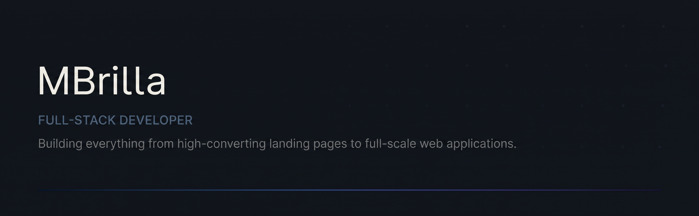

**Founder at [Tab Studios](https://tabstudios.dev) • Full-Stack Developer**

---

## About Me

I'm a full-stack developer and the founder of **Tab Studios**, where I take digital products from initial concept to deployment—whether that's a sharp, fast-loading landing page or a complex, full-scale web application.

- **Currently building:** High-converting landing pages, full-scale websites, SaaS platforms, and internal business tools
- **Focus areas:** Web architecture, responsive UI/UX, workflow automation, and rapid MVP development
- **Always exploring:** New JavaScript ecosystems, AI integrations, and cloud infrastructure

---

## Tech Stack

**Languages & Frontend**  

**Backend & Databases**  

---

## What I Build

| Category | Focus |
| :--- | :--- |
| **Landing Pages & Full-Scale Websites** | High-converting marketing sites, responsive interfaces, and complete web platforms |
| **SaaS & Startup MVPs** | End-to-end architecture, auth, billing, and rapid deployment |
| **Business Systems** | Custom dashboards, CRMs, and automated operational workflows |
| **APIs & Backend** | High-throughput REST APIs and resilient database schemas |

---

## GitHub Activity

  
  

---

  <i>"Build it simple. Scale it smart."</i>

